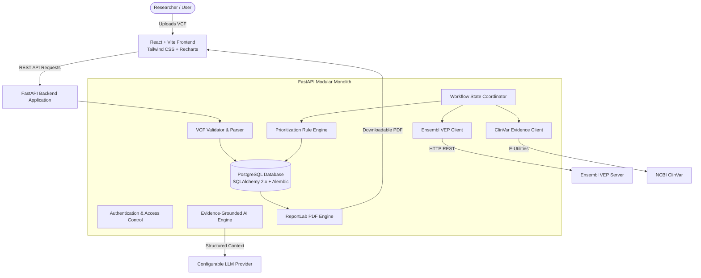

# Autonomous AI Genomic Analysis Platform

[](https://www.python.org/)
[](https://fastapi.tiangolo.com/)
[](https://react.dev/)
[](https://vitejs.dev/)
[](https://tailwindcss.com/)

> **Academic Research Support Tool Disclaimer:**  
> This platform is an educational and research-support system designed to automate genomic variant parsing, annotation, evidence retrieval, and evidence-grounded summarization. **It does not provide medical diagnoses or replace clinical geneticists.** All candidate prioritizations and AI explanations represent research exploratory findings and must undergo expert laboratory validation.

---

## 1. System Overview

The **Autonomous AI Genomic Analysis Platform** automates the end-to-end processing of Genomic Variant Call Format (VCF) files:
1. **Validation & Ingestion:** Checks VCF header compliance, format specifications (VCFv4.2/4.3), genome assembly alignment (GRCh38 / GRCh37), and file integrity.
2. **Variant Parsing & Normalization:** Extracts SNVs, Indels, and multiallelic variants into standardized coordinate objects.
3. **Bioinformatics Annotation:** Leverages the official **Ensembl Variant Effect Predictor (VEP)** REST API (or local instance) to annotate consequence types, impact levels, and affected genes/transcripts.
4. **Clinical Evidence Retrieval:** Fetches empirical records from **NCBI ClinVar** preserving accessions, clinical interpretations, review status, and conflicting records.
5. **Rule-Based Prioritization:** Applies transparent, auditable rules based on impact severity, ClinVar significance, and evidence conflict detection.
6. **Evidence-Grounded AI Explanations:** Generates strictly bounded, structured summaries that cite retrieved ClinVar and VEP data without hallucinating genetic causation.
7. **Interactive Dashboard & PDF Reports:** Visualizes variant distributions, consequence impacts, and exports audit-ready PDF reports via ReportLab.

---

## 2. Architecture Diagram



---

## 3. Project Structure

```text
autonomous-genomic-platform/
├── backend/
│   ├── app/
│   │   ├── main.py              # FastAPI application entrypoint
│   │   ├── api/                 # REST API route handlers
│   │   ├── core/                # Config, logging, security
│   │   ├── db/                  # Database session, base models
│   │   ├── models/              # SQLAlchemy database models
│   │   ├── schemas/             # Pydantic validation schemas
│   │   ├── repositories/        # Database CRUD operations
│   │   ├── services/            # Business logic services
│   │   ├── bioinformatics/      # VCF parsing, validation, VEP client
│   │   ├── evidence/            # ClinVar integration, provenance
│   │   ├── prioritization/      # Transparent scoring rules
│   │   ├── ai/                  # Evidence-grounded LLM prompts & client
│   │   ├── workflows/           # Multi-stage workflow orchestrator
│   │   └── reports/             # PDF generation via ReportLab
│   ├── tests/
│   │   ├── unit/                # Unit tests
│   │   ├── integration/         # API & DB integration tests
│   │   └── fixtures/            # Test data mocks
│   ├── requirements.txt         # Pinned Python dependencies
│   ├── pytest.ini               # Pytest configuration
│   └── .env.example             # Backend environment template
├── frontend/
│   ├── src/                     # React application source
│   ├── public/                  # Static assets
│   ├── package.json             # NPM dependencies
│   └── vite.config.js           # Vite configuration with Tailwind & proxy
├── data/
│   ├── test_fixtures/           # Synthetic VCF files for testing
│   ├── uploads/                 # Secure private upload storage
│   └── generated_reports/       # Generated PDF reports storage
├── docs/                        # Architectural & API documentation
├── .env.example                 # Root environment template
├── .gitignore                   # Security & build exclusions
└── README.md                    # Project documentation
```

---

## 4. Environment & Platform Details

### Windows vs. Linux / WSL2 Considerations
- **VCF Parsing (`cyvcf2` vs. `vcfpy`):** `cyvcf2` compiles C code against HTSlib. On native Windows without POSIX build chains, HTSlib C compilation requires MSYS2 or vcpkg. To ensure zero-friction, cross-platform execution on Windows, this platform implements a modular parser interface with `vcfpy` (pure Python VCFv4.2/4.3 standard parser) with native `cyvcf2` support for Linux / WSL2 / Docker deployments.
- **Ensembl VEP:** Ensembl VEP is integrated via its official, rate-limit-conscious REST API (`https://rest.ensembl.org`), eliminating the requirement to maintain a 30GB local offline Perl database on student machines while supporting full consequence mapping.

---

## 5. Quick Start (Windows PowerShell)

### Backend Setup
```powershell
# Navigate to backend directory
cd backend

# Create virtual environment (Python 3.12 or 3.13)
py -3.13 -m venv .venv

# Activate virtual environment
.\.venv\Scripts\Activate.ps1

# Upgrade pip and install dependencies
pip install --upgrade pip
pip install -r requirements.txt

# Run automated tests
pytest

# Start development server
uvicorn app.main:app --reload --port 8000
```
Swagger UI documentation will be available at: `http://localhost:8000/docs`

### Frontend Setup
```powershell
# In a separate PowerShell terminal, navigate to frontend
cd frontend

# Install dependencies
npm install

# Start Vite development server
npm run dev
```
Frontend interface will be available at: `http://localhost:5173`

---

## 6. Implementation Roadmap

- [x] **Phase 0:** Requirements, Environment checks, Project Skeleton, Config, and Baseline Verification
- [x] **Phase 1:** VCF Validation, Parsing Engine & Synthetic Fixtures
- [x] **Phase 2:** FastAPI Upload & Validation REST Endpoints
- [x] **Phase 3:** PostgreSQL Database Models & Alembic Migrations
- [x] **Phase 4:** Asynchronous Analysis Job Orchestration
- [x] **Phase 5:** Ensembl VEP Annotation Integration
- [x] **Phase 6:** ClinVar Clinical Evidence Retrieval & Conflict Detection
- [x] **Phase 7:** Transparent Rule-Based Candidate Prioritization
- [x] **Phase 8:** React + Vite Interactive Research Dashboard
- [x] **Phase 9:** Evidence-Grounded AI Explanation Layer
- [x] **Phase 10:** Multi-Stage Autonomous Workflow Orchestration
- [x] **Phase 11:** Audit-Ready PDF Report Generation (ReportLab)
- [x] **Phase 12:** End-to-End Testing, Security Hardening & Documentation

