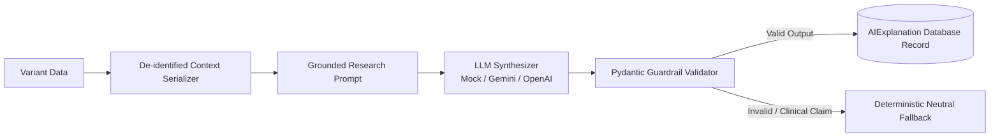

# Prioritization Matrix & AI Scientific Guardrails

Specifications for transparent candidate variant scoring and evidence-grounded AI explanation generation with zero hallucination.

---

## 1. Prioritization Scoring Matrix (Version `v1.0`)

Candidate variants are ranked using an auditable, deterministic scoring function producing scores from $0.0$ to $100.0$:

$$\text{Total Score} = \text{Score}_{\text{ClinVar}} + \text{Score}_{\text{Stars}} + \text{Score}_{\text{Impact}} - \text{Penalty}_{\text{Conflict}}$$

### A. ClinVar Clinical Significance Weighting
| Clinical Assertion | Points |
| :--- | :--- |
| **Pathogenic** | +50.0 |
| **Likely Pathogenic** | +40.0 |
| **Uncertain Significance (VUS)** | +20.0 |
| **Likely Benign** | +5.0 |
| **Benign** | 0.0 |
| **Conflicting Assertions** | +25.0 *(Flagged explicitly)* |
| **No Submissions Available** | +10.0 *(Neutral baseline)* |

### B. ClinVar Review Status Stars Confidence
| Gold Stars | Review Level | Points |
| :--- | :--- | :--- |
| **4 Stars** | Practice Guideline | +20.0 |
| **3 Stars** | Expert Panel | +15.0 |
| **2 Stars** | Multiple submitters, no conflicts | +10.0 |
| **1 Star** | Single submitter | +5.0 |
| **0 Stars** | No assertion criteria provided | +0.0 |

### C. Ensembl VEP Consequence Impact
| Impact Level | Consequence Terms | Points |
| :--- | :--- | :--- |
| **HIGH** | `transcript_ablation`, `splice_acceptor_variant`, `splice_donor_variant`, `stop_gained`, `frameshift_variant`, `stop_lost`, `start_lost` | +25.0 |
| **MODERATE** | `inframe_insertion`, `inframe_deletion`, `missense_variant`, `protein_altering_variant` | +15.0 |
| **LOW** | `splice_region_variant`, `synonymous_variant`, `stop_retained_variant` | +5.0 |
| **MODIFIER** | `intron_variant`, `downstream_gene_variant`, `upstream_gene_variant`, `intergenic_variant` | +0.0 |

### D. Priority Stratification Tiers
- **`TIER_1_CRITICAL`** ($\ge 80.0$): Well-established pathogenic alterations with high functional consequence.
- **`TIER_2_HIGH`** ($60.0 - 79.9$): Likely pathogenic alterations or high-impact functional disruptions in disease-associated genes.
- **`TIER_3_MODERATE`** ($40.0 - 59.9$): Variants of uncertain significance with moderate coding impact.
- **`TIER_4_LOW`** ($20.0 - 39.9$): Low-impact or likely benign alterations.
- **`UNCERTAIN`** ($< 20.0$): Variants lacking public clinical records or functional annotations.

---

## 2. Evidence-Grounded AI Explanation Architecture

The AI Explanation Engine synthesizes candidate variant records into structured scientific rationales while enforcing zero-hallucination guardrails:

### Non-Diagnostic Guardrails
Output is validated through the `VariantExplanationOutput` Pydantic model:
1. **Clinical Diagnosis Prohibition:** Regex guardrails inspect outputs for prohibited phrasing (`"diagnosed with"`, `"prescribe"`, `"treatment regimen"`, `"clinical prognosis"`, `"patient has"`). Any matching text triggers instant schema rejection.
2. **Mandatory Evidence Grounding:** The model must reference explicit ClinVar accessions (`VCV...`) or Ensembl transcript IDs (`ENST...`).
3. **Missing Evidence Neutrality:** Absence of records in ClinVar must be declared neutrally without asserting benignity or health implications.
4. **Explicit Scientific Uncertainties:** Output must include a non-empty list of scientific limitations (e.g. unknown zygosity, tissue-specific expression, or submitter disagreements).
