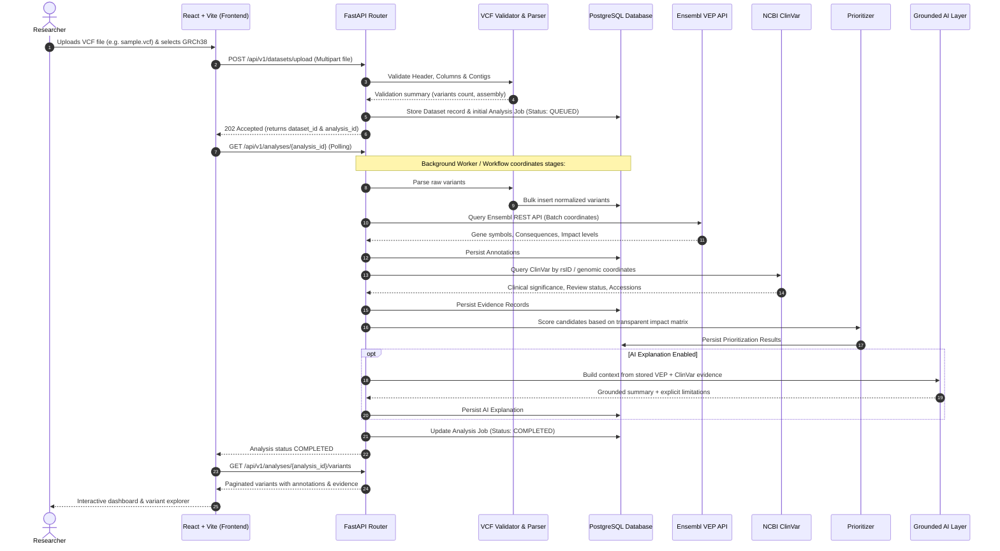

# Architecture Documentation: Autonomous AI Genomic Analysis Platform

## 1. Architectural Philosophy

The platform is designed as a **Modular Monolith**. Rather than introducing distributed microservice overhead (such as Kubernetes, RabbitMQ, and separate database clusters) at the undergraduate stage, the platform keeps clear domain boundaries in a single, high-performance Python application:

1. **Separation of Concerns:** Business logic resides in `services/`, bioinformatics protocols in `bioinformatics/`, external evidence retrieval in `evidence/`, database interactions in `repositories/`, and API contracts in `api/` and `schemas/`.
2. **Persistent Job Tracking:** Genomic analyses are asynchronous processes. Rather than holding open long HTTP connections during API queries to Ensembl or ClinVar, upload requests immediately yield a unique `analysis_id` and track state transitions (`QUEUED`, `VALIDATING`, `ANNOTATING`, `COMPLETED`, `FAILED`).
3. **Data Provenance & Traceability:** Every annotated consequence, ClinVar accession, and prioritization rationale preserves its external reference, retrieval timestamp, and tool version.
4. **Honest Evidence & Safe AI:** The system explicitly records missing information and conflicting clinical interpretations. The AI layer is bounded strictly to retrieved records and never hallucinates diagnoses or causality.

---

## 2. Component Interaction & Data Flow

---

## 3. Directory & Module Boundaries

- `app/api/`: Handles HTTP routing, input serialization, and status code dispatching.
- `app/core/`: Configuration via Pydantic Settings, application logging, and security headers.
- `app/db/`: SQLAlchemy declarative base and session management.
- `app/models/`: SQLAlchemy database entities for Users, Datasets, Analysis Jobs, Variants, Annotations, Evidence, and Reports.
- `app/schemas/`: Pydantic validation schemas enforcing data contracts between client and server.
- `app/bioinformatics/`: VCF parser, assembly verifier, coordinate normalizer, and Ensembl VEP REST client.
- `app/evidence/`: ClinVar E-utilities client, evidence mapper, and provenance tracker.
- `app/prioritization/`: Transparent, auditable scoring rules engine.
- `app/ai/`: Structured prompt generator, LLM API client, and Pydantic response validator.
- `app/reports/`: ReportLab PDF document builder.

