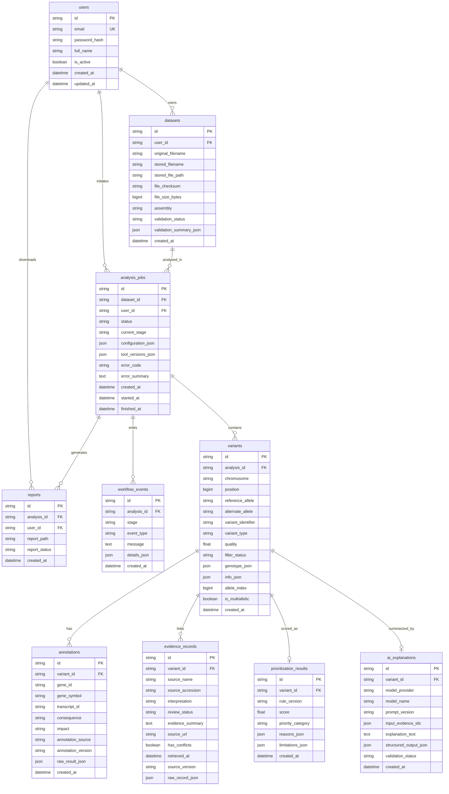

# Database Schema & Entity-Relationship Documentation

## 1. Relational Architecture Overview

The **Autonomous AI Genomic Analysis Platform** utilizes a normalized relational data model managed via **SQLAlchemy 2.x** and **Alembic**. The schema is optimized for:
1. **Auditability & Provenance:** Every variant annotation, clinical record from ClinVar, and AI summary points to its source analysis, timestamps, and tool versions.
2. **High-Throughput Queries:** Multi-column indexing on genomic coordinates (`chromosome`, `position`), gene symbols, consequence impacts, and priority tiers.
3. **Data Integrity & Privacy:** Strict foreign keys with cascade deletions, SHA-256 dataset deduplication, and separation of raw files from metadata records.

---

## 2. Entity-Relationship (ER) Diagram

---

## 3. Entity Specification

### `users`
Represents researchers and platform users.
- `id` (UUID string, PK)
- `email` (String 255, Unique, Indexed)
- `password_hash` (String 255): Stored using secure Argon2 or bcrypt.
- `full_name` (String 255, Optional)
- `is_active` (Boolean, default True)
- `created_at` / `updated_at` (Timestamps with timezone)

### `datasets`
Tracks uploaded VCF files and validation outcomes.
- `id` (UUID string, PK)
- `user_id` (UUID string, FK `users.id`, nullable for open demo mode)
- `file_checksum` (String 64, SHA-256 index for deduplication and provenance)
- `file_size_bytes` (BigInt)
- `assembly` (String 20: `GRCh38` or `GRCh37`)
- `validation_status` (String 30: `VALID`, `INVALID`, `PARTIAL`)
- `validation_summary_json` (JSON structure from bioinformatics validator)

### `analysis_jobs`
Coordinates the multi-stage asynchronous genomic pipeline.
- `status` (`QUEUED`, `VALIDATING`, `PARSING`, `ANNOTATING`, `RETRIEVING_EVIDENCE`, `PRIORITIZING`, `GENERATING_EXPLANATIONS`, `COMPLETED`, `FAILED`, `CANCELLED`)
- `current_stage` (Current execution node)
- `configuration_json` (Enabled services: VEP, ClinVar, LLM)
- `tool_versions_json` (Captured versions of VEP API, ClinVar release, etc.)

### `variants`
Stores normalized variants resulting from VCF ingestion.
- `chromosome` (Indexed: `chr1`, `chr7`, etc.)
- `position` (Indexed: 1-based coordinate)
- `reference_allele` / `alternate_allele`
- `variant_type` (`SNV`, `INSERTION`, `DELETION`, `INDEL`, `MNV`)
- `allele_index` & `is_multiallelic` (Tracks multiallelic splitting accurately)

### `annotations`
Holds consequence mappings from Ensembl VEP.
- `consequence` (e.g., `missense_variant`, `stop_gained`, `frameshift_variant`)
- `impact` (`HIGH`, `MODERATE`, `LOW`, `MODIFIER`)
- `gene_symbol` (Indexed for quick gene-level queries)

### `evidence_records`
Stores empirical records retrieved from NCBI ClinVar.
- `source_accession` (e.g. `VCV000000...`)
- `interpretation` (`Pathogenic`, `Likely pathogenic`, `VUS`, `Benign`)
- `has_conflicts` (Flag indicating disagreement between submitters)

### `prioritization_results`
Stores deterministic ranking outcomes.
- `priority_category` (`TIER_1_CRITICAL`, `TIER_2_HIGH`, `TIER_3_MODERATE`, `TIER_4_LOW`, `UNCERTAIN`)
- `reasons_json` (Audit trail of triggered rules)

### `ai_explanations`
Bounded summaries synthesized from stored evidence.
- `explanation_text` & `structured_output_json`
- `validation_status` (`VALID`, `FAILED`)

