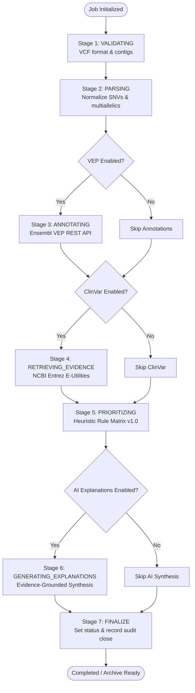

# Multi-Stage Autonomous Workflow Orchestration

Technical specification of the directed execution graph, resilient checkpointing, bounded retry policies, cooperative cancellation, and state recovery.

---

## 1. Workflow Architecture & Stage Graph

The platform coordinates genomic variant analysis as a modular, state-driven directed workflow graph:



---

## 2. State Checkpointing & Persistence

Each workflow stage maintains explicit checkpoint records:

```python
class StageCheckpoint(BaseModel):
    stage_name: str
    status: str            # PENDING, IN_PROGRESS, COMPLETED, SKIPPED, FAILED
    started_at: Optional[str]
    completed_at: Optional[str]
    retry_count: int
    metrics: Dict[str, Any]
    warning_messages: List[str]
    error_message: Optional[str]
```

Checkpoints are serialized to `AnalysisJob.configuration_json["checkpoints"]` at the completion of every stage, ensuring recovery even during process restarts or host failure.

---

## 3. Bounded Retry Policy

External network calls (Ensembl VEP REST API, NCBI Entrez E-Utilities) are subject to transient network anomalies, HTTP 429 rate limits, and server timeouts.

- **Maximum Retries per Stage:** 2 retries (3 total attempts).
- **Backoff Strategy:** Exponential backoff delay (`0.5s * attempt_number`).
- **Audit Emission:** Each retry triggers an audit event (`STAGE_RETRY`) in `workflow_events` with error details and attempt counts.
- **Fail-Safe Abort:** If attempts exceed the maximum bound, the orchestrator sets `status = "FAILED"` and records the technical reason in `error_summary`.

---

## 4. Cooperative Cancellation

Users can halt long-running analysis jobs at any time via `POST /api/v1/analyses/{id}/cancel`:
1. Database status is updated to `CANCELLED`.
2. The orchestrator checks database status before beginning each stage and before executing retry attempts.
3. Execution halts gracefully without killing worker processes or leaving corrupted partial database rows.

---

## 5. Checkpoint Recovery & Resume Semantics

When resuming a failed or cancelled analysis via `POST /api/v1/analyses/{id}/resume`:
1. The orchestrator reconstructs `WorkflowState` from the database and previous checkpoints.
2. Verified `COMPLETED` and `SKIPPED` stages are skipped automatically.
3. Execution resumes directly at the first uncompleted or failed stage.
4. **Idempotent Stage Handlers:**
   - `PARSING`: Reuses existing variant coordinates if already present in the database.
   - `ANNOTATING`: Cleans existing annotations for the target variants before persisting new consequence records.
   - `RETRIEVING_EVIDENCE`: Replaces existing evidence rows on retry.
   - `PRIORITIZING`: Replaces prior heuristic score rows to guarantee unique constraints on `variant_id`.
   - `GENERATING_EXPLANATIONS`: Updates existing `AIExplanation` records in place.

